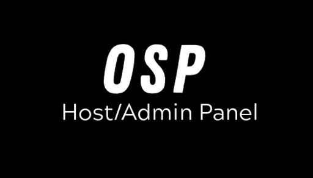

# Open Session Panel (OSP)



**A mod menu for singleplayer and an administration panel for multiplayer in Teardown.**

Open Session Panel (OSP) is a mod that brings player abilities, session controls, and multiplayer administration into a single interface.

I originally started this project to have more control over my Teardown sessions with friends. It has since grown into a more complete panel, with customizable permissions, persistent player settings, and support for both singleplayer and multiplayer.

The interface is available in English and Brazilian Portuguese.

## Features

### Player controls

Manage your own character in singleplayer or other players in multiplayer, depending on your permissions.

- **Invincibility:** Prevent damage to selected players.
- **Fly and Noclip:** Fly with collision or move freely through the environment, with adjustable speeds.
- **Super strength:** Lift heavier objects, adjust grabbing force and mass limits, and optionally throw objects.
- **Infinite ammo:** Automatically replenish ammunition for supported tools.
- **Movement speed:** Adjust player movement speed.
- **Player actions:** Heal, freeze, respawn, teleport, and bring other players to your location.

Most abilities can also be applied to multiple players at once.

### Session management

Control several aspects of the current game session:

- Adjust time, rain, and fog.
- Enable or disable health regeneration.
- Send announcements to players.
- Restart the current map.
- View an activity log of administrative actions.

### Tool management

Manage access to both vanilla and modded tools.

You can enable or block individual tools, search by name, filter between vanilla and modded tools, and apply changes to specific players or the entire session.

Global tool rules and player-specific settings configured by the host are saved between missions.

### Roles and permissions

OSP includes a permission system for multiplayer sessions.

Instead of granting someone complete administrative access, the host can decide exactly which actions that player is allowed to perform.

The panel includes five built-in roles:

- **Guest**
- **Self only**
- **Helper**
- **Moderator**
- **Administrator**

You can edit these roles or create up to 16 custom roles, assigning permissions for individual actions, other players, and administrative tasks.

Role assignments are saved between missions, and changes to a role also affect players already assigned to it.

### Customization

The interface can be adjusted to suit your preferences.

- Choose between several color palettes or create your own.
- Adjust the panel background opacity.
- Hide tabs you don't use.
- Configure the panel opening key and personal ability shortcuts.
- Switch between automatic, singleplayer, and multiplayer panel modes.
- Change the language between English and Brazilian Portuguese.

Personal interface preferences are saved locally.

## Getting started

Open the panel by pressing **P** (the default shortcut) or through the game's pause menu.

In singleplayer, you can manage your own abilities, tools, and session settings.

In multiplayer, the host has full access to administrative controls. Other players see the options available to their assigned roles, along with their personal settings.

You can also configure the interface before loading a map through **Mod Manager → Open Session Panel → Options**.

## Installation

### Steam Workshop

You can find my published Teardown mods on [my Steam Workshop page](https://steamcommunity.com/id/Luiz-AVcruz/myworkshopfiles?appid=1167630).

Subscribe to Open Session Panel and enable it through Teardown's Mod Manager.

### Manual installation

To install the source version locally:

1. Download or clone this repository.
2. Create a folder named `Open Session Panel` inside Teardown's local mods directory.
3. Copy the contents of the repository's `mod/` directory into that folder.
4. Enable the mod through the Mod Manager.

The installed folder should contain `main.lua`, `info.txt`, `options.lua`, and the accompanying scripts and assets.

Reload the map after updating the mod so the new scripts are loaded.

**Note:** The stable and Beta versions use separate saved data. Keep only one version enabled at a time, and don't mix their Workshop IDs or saved profiles.

## Saved settings and permissions

OSP saves several types of settings, but not every action is persistent.

The host's player configurations, role assignments, and tool rules can persist across missions and reconnects. Actions such as healing, respawning, and teleporting are immediate actions rather than saved states.

Personal preferences, including appearance and shortcuts, are stored locally.

The permission system is designed for ordinary multiplayer sessions. It is not an anti-cheat system and cannot guarantee protection against modified game clients.

For more information about persistence, permissions, and implementation details, see [the project documentation](Docs/PROJETO.md).

## Development

OSP is developed using Lua 5.1-compatible scripting and Teardown's modding API.

The repository contains the mod source, development utilities, tests, and project documentation.

To run the local checks or create distribution archives, you will need Python 3 and LuaJIT 2.1.

```bash
python3 tools/check.py
python3 tools/package.py
```

These commands check the project and package its files for distribution. They do not replace testing inside Teardown, particularly for multiplayer synchronization and game physics.

The mod itself does not require Python or LuaJIT to run.

### Project structure

| Directory | Contents |
|---|---|
| `mod/` | Game scripts, interface, assets, and mod metadata |
| `tests/` | Local automated checks |
| `tools/` | Validation and packaging scripts |
| `Docs/` | Technical documentation and development notes |

### Limitations

Some functionality depends on Teardown's native API and multiplayer behavior.

In particular, the permission system does not authenticate modified clients, some modded tools may use their own ammunition systems, and certain interactions involving physics or networking still require in-game verification.

The project documentation records these limitations and the checks performed so far.

## About the project

OSP started as something I wanted for my own games with friends. I decided to make it publicly available in case other players find it useful.

I used Codex to help develop the Lua code and write some of the documentation, since Lua isn't a language I'm familiar with. I directed the development and reviewed the results. No AI image generators were used.

This is a personal project, so I can't guarantee regular updates, but I'll try to address bugs and issues when possible.

## License

Open Session Panel is licensed under **AGPL-3.0-or-later**, with an additional permission for the Teardown runtime.

See [LICENSE](LICENSE) and [ADDITIONAL-PERMISSION](ADDITIONAL-PERMISSION) for the full terms.

The source code is available for anyone interested in studying, modifying, or redistributing it under those terms.

---

## Português brasileiro

O **Open Session Panel (OSP)** é um mod para Teardown que funciona como menu de controles no modo singleplayer e painel de administração no multiplayer.

Ele permite gerenciar habilidades como invencibilidade, voo, Noclip, força aumentada e munição infinita. Também oferece controles de sessão, gerenciamento de ferramentas, teleporte de jogadores e um sistema de cargos com permissões personalizáveis.

As configurações feitas pelo host, incluindo permissões, efeitos e regras de ferramentas, podem ser mantidas entre mapas. Cada jogador também pode personalizar a aparência do painel e configurar atalhos próprios.

**Para abrir:** pressione **P** ou utilize o menu de pausa.

O mod está disponível em inglês e português brasileiro. O idioma pode ser alterado nas configurações ou nas opções do gerenciador de mods.

O projeto foi criado inicialmente para minhas próprias sessões com amigos e está disponível publicamente para quem também quiser utilizá-lo. O desenvolvimento contou com assistência do Codex na programação Lua e na documentação, sob minha orientação e revisão.

Para informações técnicas, consulte a [documentação do projeto](Docs/PROJETO.md).
